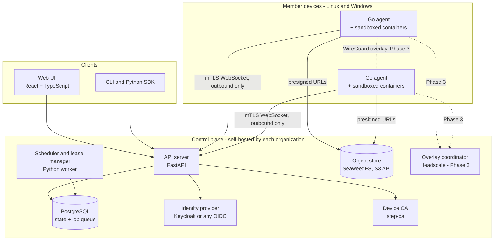
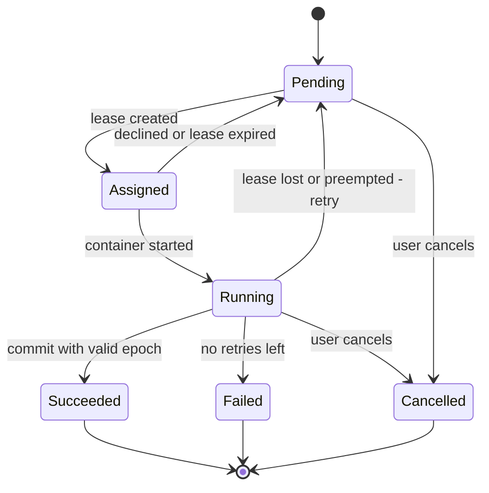

# Group Compute Platform: R&D Plan

| | |
|---|---|
| **Status** | Draft v0.1, for team review |
| **Date** | 2 November 2026 |
| **Owner** | Yaana R&D |
| **Working name** | `pool`, a placeholder used in the examples below |
| **Scope** | Linux and Windows computers. Self-hosted. Open source. No mobile devices. |

> **Security note.** Login, encryption, access control, sandboxing and data deletion are security-sensitive. Every design and code change in these areas needs review by a person with security expertise before it is merged (see [§8.10](#810-review-policy)).

---

## 0. Summary

Trusted people create a **group** (a private cluster), invite others, and share their computers with it. Members then run jobs on each other's machines. A computer can be shared with several groups, and a person can be in several groups. The device owner always keeps control: when their computer is shared, how much of it is used, and whose jobs it accepts.

**What we will build:**

- A **control plane** (FastAPI and PostgreSQL) that each organization hosts itself.
- A **web UI** (React).
- A **CLI and Python SDK**.
- A **Go agent** on each Linux or Windows computer, which runs jobs in sandboxed containers.

We reuse proven open-source parts for the hard problems: gVisor, Kata and Docker for sandboxing, Headscale with WireGuard for networking, Keycloak and step-ca for identity, and SeaweedFS for storage.

**Order of work:**

1. **Borrow one bigger machine.** Run a job on a colleague's GPU machine.
2. **Many independent pieces.** Sweeps, evaluation and test shards.
3. **Long-running services and private networking.**
4. **One job across many machines.** Distributed training. This is a research track.
5. **Hardening and public open-source release.**

---

## 1. Problem and goals

Personal and office computers sit idle for much of the day. People who need more compute either wait, shrink their work, or pay for the cloud. Groups of people who trust each other (a research team, a class, a dev team) have no simple, safe way to pool the machines they already own.

### Goals

1. Let a trusted group pool its Linux and Windows computers and run jobs on them, with no central company in the middle. Each organization self-hosts.
2. Keep the **device owner in control**: when, how much, which groups, which people.
3. Make **security the first concern**. A job must not be able to harm the computer it runs on, and groups must stay isolated from each other.
4. Handle unreliable devices as normal. Machines sleep, switch off and lose network, and jobs still finish.
5. Support every use case in [§2](#2-users-and-use-cases), delivered in phases.

### Non-goals (for now)

- Mobile devices (phones and tablets).
- macOS as a contributing device in v1. Docker on macOS cannot use the Apple GPU, so we revisit this later.
- A public marketplace, payments or crypto tokens.
- Running jobs from strangers. Every group is invite-only and trusted.
- Federation between self-hosted servers. In v1 an agent can join several servers instead (see [§7.11](#711-one-device-several-servers)).

---

## 2. Users and use cases

### 2.1 Who uses it

| Group type | Example | Owns devices | Who decides | Main need |
|---|---|---|---|---|
| Research team | Yaana research team | Company | One coordinator | Training, inference, experiments |
| Students | A university lab group | Each student | Peers | Run apps, run experiments |
| Developers | An app dev team | Mixed | Lead | Run big apps in Docker or on bare metal; split test suites |
| Course | One semester's class | University and students | Teacher | Assignments on lab PCs; ends with the semester |
| Hackathon | A 48-hour team | Each member | Team lead | Short-lived cluster that deletes itself |
| Cross-organization | Company and university paper | Each side | Both coordinators | Shared work while each side's data stays on its own devices |

### 2.2 The four job shapes

The deciding question is the **shape** of a job, not the type of user.

| Shape | Meaning | Fit on personal devices | Phase |
|---|---|---|---|
| `single` | One container on one machine ("borrow a bigger machine") | Easy | 1 |
| `array` | Many independent tasks from a parameter grid | Excellent | 2 |
| `service` | Long-running program that is restarted if it stops and reachable inside the group | Only on always-on machines | 3 |
| `gang` | Several machines that must work together on one job | Hard; needs a fast network | 4 (research) |

### 2.3 Use case coverage

| # | Who | Use case | Shape | Minimum isolation tier (see [§8.3](#83-isolation-tiers)) | Phase |
|---|---|---|---|---|---|
| 1 | Research | Train on a colleague's or the lab's GPU machine | single | T1 (GPU) | 1 |
| 2 | Research | Parameter and multi-seed sweeps (e.g. 10 seeds × 3 datasets = 30 tasks) | array | T2 CPU / T1 GPU | 2 |
| 3 | Research | Benchmark evaluation and batch inference | array | T2 / T1 | 2 |
| 4 | Research | Train one model across several machines | gang | T1 | 4 |
| 5 | Research | Run a model too big for one GPU | gang | T1 | 4 |
| 6 | Students | Run an app that needs more RAM or CPU than their own laptop | single | T2 | 1 |
| 7 | Students | Research experiments (same as #2 and #3) | array | T2 / T1 | 2 |
| 8 | Teacher | Course cluster that closes when the semester ends | group lifecycle | – | 3 |
| 9 | Developers | Run a big app in Docker on a bigger machine | single, then service | T2 / T1 | 1 / 3 |
| 10 | Developers | Multi-container app (web, database, worker) | service stack | T1 | 3 |
| 11 | Developers | Split a test suite across machines | array | T2 / T1 | 2 |
| 12 | Developers | Bare-metal run, including Windows-native tests, on a dedicated machine | single | T0 | 3 |
| 13 | Anyone | Hackathon cluster that deletes itself | group lifecycle | – | 3 |
| 14 | Two organizations | Joint research where each side's data stays home | multi-server agent | By data class | 3 |
| 15 | Creators | Render farm (one task per frame) | array | T2 / T1 | 2 |
| 16 | Small office | Night-shift builds and tests on office PCs | array with time windows | T2 / T1 | 2 |

---

## 3. Key decisions

| # | Decision | Why |
|---|---|---|
| D1 | **Open source, self-hosted.** Each organization runs its own control plane. | No central party sees the data. Fits companies and universities. |
| D2 | **Central control plane per server, not peer-to-peer.** | Simpler, easier to secure and to debug. The torrent-style idea is used only for moving data, later. |
| D3 | **Agents pull work.** Devices only make outbound connections. | Works behind home and office routers with no open ports. The owner stays in control. |
| D4 | **Go agent.** | Ships as a single file on Linux and Windows. Mature Docker client. Memory-safe. |
| D5 | **Linux and Windows in v1.** Windows runs jobs inside a dedicated WSL2 distro. | Covers most lab and office machines. Windows isolation is weaker; see [§8.3](#83-isolation-tiers). |
| D6 | **Trusted groups only.** | Removes payments and cheat detection. We still sandbox, because trusting a person is not the same as trusting their code. |
| D7 | **PostgreSQL is both the source of truth and the job queue** in v1. | One fewer system to run. Tasks are claimed with `FOR UPDATE SKIP LOCKED`. |
| D8 | **Project license: Apache-2.0** (recommended). | Includes a patent grant and is compatible with all the core dependencies we chose. See [§14](#14-license-notes). |
| D9 | **FastAPI and React** for the control plane and UI. | The team knows them. OpenAPI generates a typed client for the UI, and Pydantic generates JSON Schema for the agent protocol. |

---

## 4. Does an existing framework already do this?

**Short answer: no single framework does all of it.** Several do parts well.

| Option | Good at | Why not enough on its own | License |
|---|---|---|---|
| Kubernetes / K3s | Containers, services, mature tooling | Built for always-on data-center nodes. A node belongs to one cluster. No owner idle policies. Heavy for laptops. | Apache-2.0 |
| HashiCorp Nomad | Lighter scheduler; Docker, plain executables and GPUs | **BUSL-1.1 since Aug 2023, so not open source.** Conflicts with our open-source goal. | BUSL-1.1 |
| **HTCondor** | **Closest match.** Uses idle desktops. Owner policies (start when the keyboard is idle, suspend when the owner returns). ClassAd matchmaking. Windows execute nodes. | Pools are run by admins. No self-service groups or join approvals. Complex configuration. | Apache-2.0 |
| Slurm | Batch scheduling on dedicated clusters (HPC) | Built for dedicated clusters, not personal machines. GPL. | GPL-2.0+ |
| Ray | Python-native parallel tasks, ML tuning and training | Ray "expects to run in a safe network". Anyone who reaches its ports can run code (CVE-2023-48022, "ShadowRay"; NVD lists it as disputed). Token auth was added in 2.52 (off by default); it is on by default for local clusters since 2.59, and the release notes say 2.61 makes it the default for all clusters. | Apache-2.0 |
| BOINC | Volunteer computing at huge scale, redundancy checks | Built for public science projects, not private groups. | LGPL-3.0+ |
| Celery / Temporal | Task queues, durable workflows | No device management, sandboxing or owner policies. | BSD-3 / MIT |
| exo / Petals / Hivemind | Splitting one AI model or training run across devices | Each covers one workload. Petals has had no release since 2023. exo is CPU-only on Linux. | Apache-2.0 (exo ≥ v1.0.60) / MIT / MIT |

**Recommendation:**

- **Build a thin control plane** (FastAPI) and a **Go agent**. This is where our value is: groups, owner policies and scheduling across devices that come and go.
- **Reuse proven parts for the hard problems:**
  - sandboxing: gVisor, Kata, rootless Docker or Podman
  - networking: Headscale with WireGuard
  - identity: Keycloak or any OIDC provider, plus step-ca
  - storage: PostgreSQL and SeaweedFS
- **Use Ray, `torchrun` and Hivemind inside jobs**, never as the platform. They run only inside a job's private network.
- **Borrow ideas from HTCondor:** owner policies, matchmaking, and a separate idle-detection helper on Windows (`condor_kbdd` exists for the same reason).
- *Alternative considered:* a FastAPI and React front end on top of HTCondor as the execution backend. This is an optional Phase 0 spike, and we keep it if it saves more work than it costs.

---

## 5. Architecture



### 5.1 Components

| Component | Responsibility |
|---|---|
| **API server** (FastAPI) | REST API for the UI and CLI. WebSocket endpoint for agents. Checks authorization on every call. Writes the audit log. |
| **Scheduler** (separate Python worker) | Matches tasks to devices. Creates and expires leases. Handles retries and backup copies of slow tasks. Enforces fair share. Runs as its own process so it can be scaled or rewritten in Go if profiling shows a need. |
| **PostgreSQL** | All state: users, groups, devices, policies, jobs, tasks, leases, audit log. Also the job queue. |
| **Object store** (SeaweedFS, S3 API) | Job inputs, outputs, checkpoints and logs, addressed by content hash. Agents use short-lived presigned URLs. Any S3-compatible store can be plugged in. |
| **Identity provider** | User login through OIDC. Keycloak is bundled by default, or the organization's own login system can be used. |
| **Device CA** (step-ca) | Issues short-lived mTLS certificates to enrolled devices. |
| **Overlay coordinator** (Headscale, Phase 3) | WireGuard mesh, needed only for services and gang jobs. |
| **Go agent** | Enrollment, heartbeats, capability reports, **local owner policy**, idle detection, running containers, uploading results, kill switch. |
| **Web UI** (React) | Groups, members, join requests, devices, sharing policies, jobs, logs, a per-device "what ran here" view, the audit log. |
| **CLI and SDK** (Typer) | `pool submit job.yaml`, `pool logs`, `pool sweep`; checkpoint helpers for jobs. |

### 5.2 Technology stack

| Layer | Choice | License | Notes |
|---|---|---|---|
| API | FastAPI, Pydantic | MIT | REST and WebSocket |
| Database access | SQLAlchemy, Alembic | MIT | Migrations |
| Database and queue | PostgreSQL | PostgreSQL | `SKIP LOCKED` task claiming |
| Web UI | React, TypeScript, Vite, TanStack Query | MIT / Apache-2.0 | Typed client generated from OpenAPI |
| CLI and SDK | Typer | MIT | |
| Agent | Go, `github.com/moby/moby/client` | BSD-3 / Apache-2.0 | `github.com/docker/docker` is deprecated from Docker v29 |
| Container engine | Docker Engine (Moby) or Podman, rootless | Apache-2.0 | **Not Docker Desktop.** It is proprietary and paid for organizations with 250+ employees or $10M+ revenue. |
| Sandbox | gVisor; Kata Containers (Linux with KVM) | Apache-2.0 | See [§8.3](#83-isolation-tiers) |
| GPU in containers | NVIDIA Container Toolkit (CDI) | Apache-2.0 | |
| Identity | Keycloak or any OIDC provider | Apache-2.0 | |
| Device certificates | step-ca | Apache-2.0 | |
| Object store | SeaweedFS | Apache-2.0 | MinIO was archived in April 2026, so we avoid it |
| Overlay network (Phase 3) | Headscale and the Tailscale client; Nebula as fallback | BSD-3 / MIT | |
| Secrets (later) | OpenBao | MPL-2.0 | Not HashiCorp Vault, which is BUSL |
| Supply chain | cosign, Trivy | Apache-2.0 | |
| Observability | OpenTelemetry, Prometheus | Apache-2.0 | Grafana is optional and runs as a separate service (AGPL) |
| In-job frameworks | PyTorch, Ray, Hivemind | BSD-3 / Apache-2.0 / MIT | Only inside a job's private network |

---

## 6. Core concepts and data model

### 6.1 Entities

```
User ──owns──▶ Device ──shared via DeviceShare (policy)──▶ Group
User ──Membership (role)──▶ Group
Group ──has──▶ Invite, JoinRequest ──▶ Approval
Group ──has──▶ Job ──has──▶ Task ──has──▶ Attempt (lease, epoch)
Task ──reads/writes──▶ Artifact (content hash)
Everything ──▶ AuditEvent (append-only, hash-chained)
Group ──▶ UsageLedger (CPU-hours, GPU-hours per member)
```

### 6.2 Roles

| Role | Can |
|---|---|
| **Coordinator** | Everything in the group: settings, approval rule, data class, remove members, close the group |
| **Admin** | Approve join requests, manage invites, read the audit log |
| **Member** | Submit jobs, share devices, vote on join requests (if the rule allows) |
| **Contributor** | Share devices only (e.g. a lab machine's service account) |
| **Submitter** | Submit jobs only (e.g. a student with no spare device) |

### 6.3 Joining and leaving

1. **How people join:** an invite link (expiring, with a maximum number of uses), or a join request with a short message.
2. **Approval rule, set per group by the coordinator:**
   - `coordinator-only`, the default for company teams
   - `any-k-members`, e.g. 2, which suits student groups
   - `majority`
3. **Probation (optional):** a new member's jobs run only on devices whose owners chose "accept jobs from new members".
4. **Removal takes effect immediately:**
   - running jobs are cancelled
   - that person's devices stop serving the group
   - group secrets they could reach are flagged for rotation
   - an audit event is written
5. **Group lifecycle:** a group is `permanent`, or `expires-at` a date (course, hackathon). When it expires, jobs stop and data is kept for N days, then deleted.
6. **Templates:** research team, course, hackathon and dev team, each with sensible defaults.

### 6.4 Device sharing policy (owner-controlled, enforced by the agent)

The owner edits this in the UI. The agent stores it **locally** and enforces it even if the server asks for something else.

```yaml
# Example local policy on one workstation (synthetic names)
shares:
  - group: research-team
    when:
      weekdays: "19:00-08:00"
      weekends: all-day
      only_when_idle: 10m          # no keyboard or mouse input for 10 minutes
    limits: { cpu_percent: 75, memory: 24Gi, gpu: true, disk: 100Gi }
    accept_from: all-members
    on_owner_return: checkpoint-and-stop   # or: pause | throttle
  - group: uni-ml-lab
    when: { only_when_idle: 15m }
    limits: { cpu_percent: 50, memory: 8Gi, gpu: false, disk: 20Gi }
    accept_from: [members-i-approve]
    on_owner_return: pause
priority: [research-team, uni-ml-lab]       # used when both groups want the machine
isolation:
  allow_tiers: [T1, T2, T3]                 # T0 (bare metal) is off by default
egress: deny                                # jobs get no internet unless allowed here
kill_switch: true                           # one click stops everything immediately
```

### 6.5 Job specification

```yaml
apiVersion: pool/v1alpha1
kind: Job
metadata:
  name: probe-seed-sweep
  group: research-team
spec:
  shape: array                 # single | array | service | gang
  image: registry.example.org/research/probe@sha256:<digest>   # pinned by digest
  command: ["python", "train_probe.py", "--seed", "{{seed}}", "--dataset", "{{dataset}}"]
  matrix:
    seed: [0, 1, 2, 3, 4, 5, 6, 7, 8, 9]
    dataset: [imdb, amazon_polarity, ag_news]   # 10 × 3 = 30 independent tasks
  resources:
    cpu: 4
    memory: 16Gi
    gpu: { count: 1, vendor: nvidia, min_memory: 8Gi }
  isolation: { min_tier: T1 }   # T1 or stronger; see §8.3
  network: { egress: none }
  data:
    inputs:  [{ ref: "sha256:<hash>", mount: /data }]
    outputs: { path: /out }
  checkpoint: { path: /ckpt, every: 10m }
  retries: 3
  max_runtime: 2h
  data_class: internal          # public | internal | confidential
  secrets: []                   # names only; values are never in the spec
```

---

## 7. Distributed system design

### 7.1 Scheduling: two levels

1. **Group scheduler (server):** decides which device should run a task.
2. **Device admission (agent):** decides whether to accept it, under the owner's local policy. The agent can always say no.

**Matching steps:**

- **Hard filters:** OS and CPU type; RAM; disk; GPU vendor, count and memory; isolation tiers available; the data class is allowed on this device; the share's time window is active and the device is idle if required; the submitter is accepted; the group's share limits are not exceeded.
- **Score:** estimated speed, plus reliability score, plus data locality (inputs already cached), plus the owner's priority for this group, plus the member's fair-share deficit, minus the expected chance of preemption (from the device's online-hours history).

**Pull model:** the agent keeps one WebSocket open and sends `ready` with its free capacity. The scheduler answers with an offer, and the agent `accept`s or `decline`s it. A declined task goes straight back to the queue.

### 7.2 Leases, heartbeats and fencing

- Every running attempt holds a **lease**: `lease_id`, `epoch` (a number that only goes up), and `expires_at`.
- **Starting defaults, all configurable:** the agent sends a heartbeat every 15 s, and a lease lasts 60 s from the last heartbeat.
- **Fencing:** every commit and upload carries the lease `epoch`. If a task was reassigned (epoch 2), a late commit from the old device (epoch 1) is **rejected**. This prevents duplicate or conflicting results.
- **Idempotency:** every message that changes state carries an idempotency key, and a result commit is idempotent per (task, attempt).
- **Execution guarantee:** a task may run more than once, but exactly one result is committed. Tasks must be safe to re-run, and each attempt writes outputs to its own path.

### 7.3 Task state machine



### 7.4 Failure handling

| Failure | How we detect it | What happens |
|---|---|---|
| Device powers off or sleeps | Heartbeats stop; the lease expires | Task returns to `Pending`, attempt count +1, resumes from the last checkpoint |
| Short network drop | Gap shorter than the lease time | Agent keeps running, buffers logs, reconnects with backoff and jitter |
| Long network drop while the device keeps computing | Lease expires; the task is reassigned with epoch 2 | The old device's late commit (epoch 1) is rejected |
| Container crashes | Exit code | Retry with backoff up to `retries`, then `Failed` |
| Slow device | Runtime above 1.5 × the 90th percentile of sibling tasks | A backup copy runs on another device; the first valid commit wins and the other is cancelled |
| Owner comes back | Idle detector | Per policy: pause, throttle, or checkpoint and stop (back to `Pending`) |
| Disk full | Agent checks before starting and while running | Agent refuses the task or stops with a clear error; device marked degraded |
| Control plane down | Agent can't reach the API | Agent finishes current tasks, queues results and never starts new work. After a restart the server waits for agents to reconnect and report before it expires any leases. |
| Unreliable device | Reliability score drops | Gets shorter tasks or none; owner notified |
| Task that always fails | Same task failed on 2 or more different devices | Marked `Failed` so it doesn't waste more devices |

### 7.5 Checkpointing

- The SDK helper `pool.checkpoint.save(path)` writes to `/ckpt`. The agent uploads checkpoints every `every` interval and on shutdown (SIGTERM, with a grace period).
- On retry, the newest checkpoint is mounted read-only, and the job resumes from it.
- Jobs without checkpoint support still work; they restart from the beginning.

### 7.6 Preemption and owner experience

- Owner activity is detected locally:
  - **Linux:** logind idle hint or input activity, to be confirmed in a Phase 0 spike.
  - **Windows:** a small helper process in the user's session reports input activity. The agent's Windows service runs in a separate session and cannot see input itself; this is the same reason HTCondor ships `condor_kbdd`.
- **Actions:** `pause` (freeze the container), `throttle` (lower the CPU share and cap memory), or `checkpoint-and-stop`.
- A tray icon or status page shows what is running and who sent it, with a **kill switch** that stops everything immediately.

### 7.7 Fairness

- **Across groups on one device:** the owner's `priority` list, plus each share's limits.
- **Inside a group:** members who used fewer CPU-hours and GPU-hours over the last 7 days go first.
- **Optional credit mode** for peer groups: sharing hours earns credits, and running jobs spends them. No money is involved.
- **Rate limits** on submissions per member stop accidental floods.

### 7.8 Moving data

- Inputs and outputs are addressed by content hash (SHA-256) and stored in the object store. Agents download them through presigned URLs that expire after 15 minutes.
- Each agent keeps a **per-group cache**, never shared across groups, to prevent leaks. A cache hit raises the device's score.
- Datasets can be "pinned" to chosen devices ahead of time.
- **Research, Phase 4:** device-to-device transfer of large datasets, like a torrent. This is where the original torrent idea fits.

### 7.9 Gang jobs (research track)

- **All-or-nothing reservation:** the scheduler reserves N devices within a timeout or releases them all.
- **Topology:** agents measure latency and bandwidth to group peers over the overlay. The scheduler prefers devices on the same LAN. Starting thresholds: latency under 2 ms and at least 1 Gbps.
- **Templates:**
  - `torchrun` (PyTorch DDP) on a fast LAN.
  - An ephemeral Ray cluster inside the job's private network, with token auth on and never exposed.
  - Low-communication training in the Hivemind or DiLoCo style for slower links. DiLoCo syncs every ~500 inner steps in the paper; INTELLECT-1 synced every 100 steps across 3 continents.
- **Failure:** in v1 the whole gang restarts from the last checkpoint. Elastic gangs (members joining and leaving mid-run) are a research item.

### 7.10 Services

- Placed only on devices the owner marks **always-on**. Health checks and a restart policy apply.
- Reachable only inside the group through the overlay, at `<service>.<group>.internal`. Never exposed to the public internet in v1.
- **Stacks with several containers** (Compose-style) first run all containers on one device. Spreading a stack across devices comes later.

### 7.11 One device, several servers

A student may belong to the university's server and to Yaana's server. The agent supports several **enrollments** (profiles), each with its own key, certificate and policy, and a local priority order between them. Nothing is shared between profiles. There is no server-to-server federation in v1.

### 7.12 Agent protocol (v1alpha1)

All messages travel over WebSocket with HTTPS and mTLS. Schemas are defined in Pydantic, exported as JSON Schema and generated into Go types.

| Direction | Message | Purpose |
|---|---|---|
| A → S | `Enroll(one_time_code, public_key, device_facts)` | First registration; returns a certificate |
| A → S | `Hello(agent_version, profile, capabilities, policy_digest)` | Session start: CPU, RAM, GPUs (via NVML), disk, OS, isolation tiers available |
| A → S | `Heartbeat(running_attempts[epoch], usage, owner_active)` | Every 15 s; renews leases |
| A → S | `Ready(free_capacity)` | Asks for work |
| S → A | `Offer(signed_task_envelope, lease_id, epoch, expires_at)` | Proposed task |
| A → S | `Accept` / `Decline(reason)` | Admission result |
| A → S | `Progress(log_chunk, checkpoint_ref)` | Streaming |
| A → S | `Commit(task, attempt, epoch, output_hashes, exit_code)` | Result (fenced) |
| S → A | `Cancel(attempt)` / `Preempt(attempt)` / `Revoke(group)` | Stop work |

The server signs each task envelope (Ed25519) after checking authorization. The agent verifies the signature against a pinned key, **and** checks the group and submitter against its local policy.

---

## 8. Security design

### 8.1 Principles

1. **The device owner has the final say.** The agent enforces the owner's local policy even if the server asks for something else.
2. **Deny by default.** No network, no host files and no secrets unless explicitly granted.
3. **Trusting a group is not trusting its code.** Every job is sandboxed, including jobs from friends.
4. **Credentials are short-lived:** device certificates, presigned URLs and tokens.
5. **Everything is visible.** Owners can see every job that ran on their device and who sent it.
6. **Assume a breach and limit the damage.** Every job, group and device is isolated from the others.

### 8.2 Threat model

| # | Threat | Example | Main mitigations | Remaining risk |
|---|---|---|---|---|
| 1 | Job harms the device owner | Reads personal files, mines crypto, scans the home or office LAN | Isolation tiers ([§8.3](#83-isolation-tiers)); no host mounts; no network by default; LAN and metadata IPs always blocked; resource and time limits; kill switch; audit | Sandbox escape bugs; Windows isolation is weaker |
| 2 | Device owner reads the job's data | Owner inspects the job's memory or disk while it runs | Data classes; confidential data only on dedicated, org-owned devices; secrets only where the group allows | Unavoidable on consumer hardware; documented plainly |
| 3 | Device returns a wrong result | Bug, faulty hardware, or a dishonest member | Trusted groups; reliability score; optional `verify: 2` runs two copies and compares output hashes, with a tolerance for GPU math | Expensive for every job, so it's opt-in |
| 4 | Stolen laptop or agent key | Thief replays the agent's credentials | 24 h certificates; revoke from the UI; key in protected storage; re-enrollment needs the owner's login | Window of up to 24 h unless revoked sooner |
| 5 | Compromised user account | Phished password | OIDC with MFA (required for coordinators and admins); approval needs k people; audit; alerts on unusual activity | Damage limited to that user's rights |
| 6 | Member targets another member's device | Sends a job crafted to attack a specific machine | Owner's `accept_from` list; submitter recorded on every job; rate limits; fast removal | Same as #1 |
| 7 | Leak between groups on a shared device | Group A's job reads Group B's cache | New container for every attempt; per-group caches and volumes, wiped afterwards; per-job network ([§8.7](#87-network)) | GPU memory may not be cleared between jobs (research item) |
| 8 | Control plane is compromised | Attacker pushes jobs to every device | Agent enforces local policy and image allowlist; pinned server key; signed agent updates; optional submitter-signed jobs (Phase 5) | Can still run jobs inside each owner's policy |
| 9 | Malicious container image | Backdoored base image | Images pinned by digest; per-group registry allowlist; optional cosign verification; Trivy scan at submit | Unknown vulnerabilities |
| 10 | Network attacker in the middle | Fake server on café Wi-Fi | TLS 1.3 with mTLS; WireGuard overlay; pinned CA | – |
| 11 | In-job framework exposed | Ray ports reachable from the LAN ("ShadowRay") | Ray and similar tools run only inside the job's private network, with token auth on | – |
| 12 | Resource abuse | One member floods the group | Quotas, fair share, rate limits, credits | – |

### 8.3 Isolation tiers

**A higher number means stronger isolation.** "Minimum T1" means the job may run on T1, T2 or T3, but never on T0.

| Tier | Linux | Windows (WSL2) | GPU | Default use |
|---|---|---|---|---|
| **T3 Micro-VM** | Kata Containers (needs KVM) | Not supported (needs nested virtualization; not documented for WSL2) | Research item | High-sensitivity CPU jobs on Linux |
| **T2 Sandboxed** | gVisor (`runsc`) with a rootless engine | Not in v1 (gVisor in WSL2 is unverified; spike S3) | gVisor GPU support (`nvproxy`) is official only for NVIDIA T4, A100, A10G, L4 and H100. Consumer GPUs to be tested (spike S1). | CPU jobs on Linux |
| **T1 Hardened container** | Rootless Docker or Podman (`runc`), user namespaces, seccomp, all capabilities dropped, `no-new-privileges`, read-only root filesystem, non-root user, no host mounts | The same, inside a dedicated WSL2 distro ([§8.5](#85-windows-specifics)) | NVIDIA Container Toolkit (CDI) | GPU jobs; all Windows jobs |
| **T0 Bare metal** | Runs as an unprivileged service account on a **dedicated** machine | Same; also covers Windows-native jobs | Native | Opt-in only, full trust |

**Controls for every container tier:**

- No network by default.
- Private LAN ranges, link-local addresses and cloud metadata addresses stay blocked even when egress is allowed.
- Limits on CPU, memory, disk and process count, plus a maximum runtime.
- A new container for every attempt. Scratch space is wiped afterwards.

### 8.4 Linux specifics

- The agent runs as a systemd service under its own user and uses a rootless container engine.
- `runsc` is registered as a runtime, and Kata is added where KVM is available.
- GPU jobs use gVisor `nvproxy` on supported GPUs, and T1 otherwise. gVisor's own documentation says it gives limited protection against bugs in the NVIDIA driver.

### 8.5 Windows specifics

- The agent runs as a Windows service, plus a small helper in the user's session for idle detection.
- Jobs run in a **dedicated WSL2 distro** that the agent creates and manages. Its `/etc/wsl.conf`:

  ```ini
  [automount]
  enabled = false        # do not mount C:\, D:\ ... into the distro
  mountFsTab = false

  [interop]
  enabled = false        # cannot start Windows programs
  appendWindowsPath = false
  ```

- The container engine is Docker Engine or Podman inside the distro, rootless. Not Docker Desktop.
- GPU access uses the NVIDIA Container Toolkit with CDI (`nvidia-ctk cdi generate`). Never install a Linux NVIDIA driver inside WSL. Only `--gpus all` is supported.
- **Residual risks, stated plainly to owners:**
  - All WSL2 distros share one VM and one kernel. A kernel-level escape could reach the owner's other WSL distros.
  - Root inside the distro could edit `wsl.conf`. To prevent this, containers never run as root, the engine is rootless, and the agent checks the configuration every time it starts.
  - gVisor and Kata are not available, so **Windows tops out at T1**. Groups can require `os: linux` for sensitive work.
- *Research option:* an agent-managed Hyper-V VM per device for stronger isolation.

### 8.6 Identity and keys

- **Users:**
  - OIDC login, with MFA required for coordinators and admins and configurable for everyone else.
  - CLI tokens are scoped and expire.
- **Devices:**
  - The agent generates an Ed25519 key pair on the device, and the private key never leaves it. On Linux it's a file only the agent user can read, with TPM support later. On Windows, OS-protected storage, chosen in Phase 0.
  - Enrollment uses a one-time code, valid for 10 minutes, shown in the UI to the signed-in owner.
  - step-ca issues a **24-hour** mTLS certificate that renews automatically. Revocation means the certificate is no longer renewed and goes on an immediate deny list.
- **mTLS termination:**
  - TLS terminates at the reverse proxy, or at uvicorn in small setups.
  - If the proxy passes client-certificate details to FastAPI in a header, it **must strip that header from incoming requests**. Forgetting this is a common and serious bug.
- **Jobs:**
  - The server signs task envelopes, and the agent pins the server's CA and signing key at enrollment.
  - Phase 5 option: members sign their own job specs, so even a compromised server cannot forge a job in a member's name.

### 8.7 Network

- **Phases 1 and 2:** agents make outbound HTTPS connections only. Devices have **no open inbound ports**.
- **Containers:**
  - `network: none` by default.
  - If the owner's policy allows egress, a job can declare a domain allowlist, enforced by an egress proxy that the agent runs.
  - LAN and metadata addresses are always blocked.
- **Phase 3 overlay:**
  - Headscale with WireGuard. Its policy is stored in the database and can be updated through its API, and it supports tags. It has one network (tailnet) per server and is still version 0.x.
  - **Per-job isolation:** each service or gang job gets an ephemeral, tagged overlay identity in a sidecar container. The access rules allow `tag:job-X ↔ tag:job-X` only, plus group members reaching published services.
  - Spike S5 validates this. The fallback is Nebula, with short-lived per-job certificates that carry the group name.
- **Ray and other frameworks inside jobs** listen only on the job's private network, with token auth on.

### 8.8 Data, secrets and deletion

| Data class | Allowed devices | Allowed tiers |
|---|---|---|
| `public` | Any device shared with the group | T0–T3 |
| `internal` | Any device shared with the group | T0–T3 |
| `confidential` | Only devices marked **org-owned and dedicated** | T2, T3; T1 only with coordinator approval (needed for consumer GPUs) |

- **Artifacts:** a bucket per group, encryption at rest, presigned URLs valid for 15 minutes, and a retention policy per group.
- **Secrets:**
  - Stored with envelope encryption, using a master key kept outside the database (an environment variable or KMS in v1, OpenBao later).
  - Delivered only when the job starts, over mTLS. Mounted on `tmpfs` and deleted after the attempt.
  - The log scrubber masks secret values.
  - A group setting controls where secrets may go: `submitter-devices`, `dedicated-devices` or `all-group-devices`.
- **Known limit:** an owner with admin rights can read the memory of a job running on their machine, including its secrets. Consumer hardware can't prevent this, which is why data classes exist.
- **Deletion:**
  - Closing a group or removing data requires explicit confirmation by the coordinator.
  - Deletion happens after the retention period and is recorded in the audit log.
  - The platform never deletes user data automatically without a configured, visible rule.

### 8.9 Supply chain and audit

- **Images:**
  - Pinned by digest, with a per-group registry allowlist and an optional cosign signature policy.
  - Trivy scans at submit time and warns, or blocks critical issues if the group chooses.
- **Agent releases:** signed with cosign and published with an SBOM. The agent verifies an update before installing it, and owners can pin an agent version.
- **Audit log:**
  - An append-only table where each row stores the hash of the previous row, so tampering is detectable.
  - It records logins, invites, join requests, approvals, removals, policy changes, device enrollment and revocation, job submit, start and stop, secret delivery, and data deletion.
  - It powers the per-device "what ran here" view and can be exported as JSON.
- **Alerts:** a burst of submissions, many device enrollments in a short time, or repeated declines.

### 8.10 Review policy

- **CODEOWNERS require a security reviewer** for these paths:
  - `control-plane/auth`, `control-plane/authz`, `control-plane/secrets`, `control-plane/audit`
  - `agent/sandbox`, `agent/policy`, `agent/enroll`
  - `protocol/`
- At the end of every phase: update the threat model, complete the security checklist, and pass the sandbox test suite.
- **An external penetration test is required before public release.**

---

## 9. Phased plan

Estimates are rough, assume 3–4 engineers, and will be revisited after Phase 0. Every phase ends with a security gate ([§8.10](#810-review-policy)).

### Phase 0: Foundations and spikes (≈3–4 weeks)

- **Validate with users first** ([§13](#13-validate-with-users-first)): interview 5–8 researchers and take a hardware inventory.
- Write threat model v1 and the decision records (ADRs) for D1–D9. Set up the repository, CI, CODEOWNERS and the protocol schema skeleton.
- **Spikes**, each producing a one-page result:

  | Spike | Question |
  |---|---|
  | S1 | Does gVisor `nvproxy` work on **our** GPUs? Consumer cards are not on the official list. |
  | S2 | Rootless Docker or Podman with NVIDIA CDI in a dedicated WSL2 distro with automount and interop off. Try to escape to Windows files. |
  | S3 | Does gVisor run inside WSL2? This decides the Windows tier. One report says it fails. |
  | S4 | Idle detection: Linux desktop sessions, and the Windows user-session helper. |
  | S5 | Headscale ephemeral tagged nodes per job: how fast can the policy be updated? Compare with Nebula. |
  | S6 | PostgreSQL queue throughput with `SKIP LOCKED` at our target scale. |
  | S7 (optional) | HTCondor as the execution backend. |

- **Exit:** spike reports written; Windows tier decided; target scale set (devices per server, tasks per day).

### Phase 1: Borrow a bigger machine, `single` (≈8–10 weeks)

- OIDC login (Keycloak bundled); groups, roles, invites, join requests with approval rules, removal.
- Device enrollment (one-time code and step-ca mTLS); the Go agent on Linux and Windows/WSL2; capability reports; local policy; kill switch.
- `single` jobs on T2 (Linux CPU) and T1 (GPU and Windows); log streaming; inputs and outputs through SeaweedFS; basic leases and retries.
- Audit log and the "what ran here" view; web UI; CLI; one-server `docker compose` deployment.
- **Exit criteria:**
  - A researcher runs a training job on a colleague's GPU machine, end to end, from the CLI.
  - Invite → enrolled device → first job takes **under 15 minutes**.
  - Sandbox tests pass: a job cannot read host files, reach the LAN, or see Windows drives.
  - Security gate passed.

### Phase 2: Many pieces, fault tolerance and owner policies, `array` (≈8–10 weeks)

- Array jobs from a matrix; fencing epochs; retries with backoff; detection of tasks that always fail; backup copies of slow tasks; checkpoint SDK; reliability score.
- Matching and scoring; time windows; idle detection; preemption actions; devices in several groups with priorities; fair share and optional credits; per-group caches and data locality.
- **Exit criteria:**
  - **Chaos test:** random agent kills, network cuts and server restarts. Every task still ends in exactly one final state, and **no result from a stale epoch is ever committed**.
  - The speedup of a 30-task sweep over one machine is measured and shared internally.
  - Owner survey: at least 90% notice no slowdown.

### Phase 3: Services, networking and advanced groups (≈10–12 weeks)

- Headscale overlay; per-job network isolation; `service` jobs on always-on devices; Compose-style stacks on one device; internal DNS names.
- T3 (Kata) on Linux with KVM; T0 bare metal on dedicated machines.
- Group expiry and templates (course, hackathon); data classes enforced; secret delivery; agent profiles for several servers.
- **Exit criteria:**
  - A dev team runs a web, database and worker app that is reachable only inside its group.
  - A penetration test of network isolation passes, with two groups on the same device.
  - One trial with a real class using the course template.

### Phase 4: Research track, one job across many machines, `gang` (in parallel after Phase 2, ≥8 weeks)

- Gang reservation and topology probes.
- Templates: `torchrun` DDP on a LAN; an ephemeral Ray cluster with token auth; Hivemind or DiLoCo-style training for slow links; split inference.
- Experiments: throughput compared with a single GPU; effect of sync interval and bandwidth; LAN compared with WAN.
- **Exit:** a written research report with measured results. A negative result is still a result.

### Phase 5: Hardening and open-source release (≈6–8 weeks)

- External security review and penetration test.
- Fuzzing of the agent's protocol parsers (Go native fuzzing).
- Authorization-matrix tests for every endpoint.
- Signed releases and SBOMs; upgrade and migration path; backups; PostgreSQL high-availability guide; optional Helm chart.
- Documentation, including a plain-language **owner guide**: what runs on my computer and how do I stop it?
- Governance files: `LICENSE` (Apache-2.0), `CONTRIBUTING`, `SECURITY.md` with a disclosure process, code of conduct.
- **Exit:** release candidate published, with all critical and high findings fixed.

---

## 10. Testing and verification

| Level | What | How |
|---|---|---|
| Unit | API handlers, scheduler logic, agent policy engine | `pytest`, `go test` |
| Contract | Python and Go agree on every protocol message | Shared JSON fixtures checked by both |
| Integration | Control plane, 3 Linux agents and 1 Windows agent | `docker compose` and VMs |
| Chaos | Kill agents; cut or slow the network; restart the server; skew clocks | `tc netem` on Linux, scripted VM power-off |
| Invariants (after every chaos run) | Exactly one final state per task; no stale-epoch commits; no lost tasks; audit hash chain valid | Automated checker |
| Security | Escape attempts (host files, LAN, metadata IP, Windows drives); authorization matrix; fuzzing | Custom suite, `go test -fuzz` |
| Performance | Scheduler and queue at the target scale | Load generator |
| Pilot | Yaana research team on real hardware | Weekly feedback |

Nothing is called "done" until its tests pass in CI. Spike results are recorded as written reports, not opinions.

---

## 11. Success metrics (pilot)

| Metric | Target (final numbers set after Phase 0) |
|---|---|
| Invite to first job | < 15 minutes |
| Tasks that finish (succeed or fail cleanly) with no manual help, under chaos testing | ≥ 99% |
| Results committed from stale leases | 0 |
| Sweep speedup compared with one machine | ≥ N×, with N set from the hardware inventory |
| Idle GPU-hours put to use per week | Tracked; should rise |
| Owners reporting a noticeable slowdown | < 10% |
| Open sandbox-escape or cross-group-leak findings at release | 0 |

---

## 12. Risks and open questions

| Risk | Impact | Mitigation |
|---|---|---|
| Windows isolation is weaker (shared WSL2 VM, no gVisor or Kata) | More harm if a job is malicious | T1 is the maximum on Windows; a Linux-only option for sensitive groups; clear disclosure to owners; research a Hyper-V VM |
| gVisor GPU support officially covers data-center GPUs only | GPU jobs on consumer cards drop to T1 | Spike S1; T1 plus trusted submitters for GPU work |
| Company IT policy may forbid running colleagues' jobs on company machines | Pilot blocked | **Get Yaana IT approval before the Phase 1 pilot** |
| Not enough idle capacity at the times people need it | Little value | Validate in [§13](#13-validate-with-users-first) before Phase 2 |
| Owner annoyance (fan noise, heat, slowdown) | People stop sharing | Conservative defaults, idle-only, throttling, one-click kill switch |
| Headscale is 0.x with a single tailnet | Overlay problems at scale | Spike S5; Nebula fallback; the overlay isn't needed until Phase 3 |
| Python scheduler too slow at scale | Delays | Separate process; profile; move hot paths to Go if needed |
| Training across a WAN may not beat one GPU | Phase 4 negative result | It's research; start with LAN |
| Owners can read the memory of a running job | Data exposure | Data classes; confidential work only on dedicated devices |
| A copyleft or source-available dependency slips in | License conflict | License check in CI ([§14](#14-license-notes)) |
| Owners pay the electricity | Fairness complaints | Usage ledger visible to all; credit mode |

**Open questions:**

1. What is the target scale per server (devices, members, tasks per day)?
2. Which GPUs does Yaana actually have? This affects S1.
3. Do we need Windows-native jobs anywhere other than T0 bare metal?
4. Should owners see the full job contents (image, command), or only metadata (who, what group, resources)? This trades privacy against transparency.
5. What are the default data-retention periods per group type?
6. Will the university side run its own server, or join Yaana's?

---

## 13. Validate with users first

Interview **5–8 researchers** before writing Phase 2 code:

1. The last time you waited on compute, what were you running, and how long did you wait?
2. What did you do instead: cloud, a smaller model, an overnight run, or gave up?
3. What hardware do you have, and when is it usually idle?
4. Would you let a teammate's job run on your machine? Under what conditions?

**Hardware inventory** (no personal data): machine type, OS, CPU cores, RAM, GPU model and memory, usual idle hours, always-on (yes or no).

**How to read the answers:**

- **Mostly "borrow a machine":** Phase 1 is the product.
- **Mostly "too many runs":** move Phase 2 forward.
- **Mostly "one huge run":** Phase 4 moves up in priority, and it becomes a harder project.

---

## 14. License notes

Checked on 2 November 2026 against each project's LICENSE file or official pages. **This is not legal advice.** Have counsel review it before public release.

- **Compatible core stack** ([§5.2](#52-technology-stack)): MIT, BSD, Apache-2.0, the PostgreSQL license and MPL-2.0. All work with an Apache-2.0 release.
- **Avoid:**
  - HashiCorp **Nomad** and **Vault**: BUSL-1.1 since August 2023, which is source-available, not open source.
  - **MinIO**: AGPL, and its repository was archived in April 2026.
  - **Docker Desktop**: proprietary, and paid for organizations with 250+ employees or $10M+ revenue. Never bundle or require it.
  - Authentik's proprietary `enterprise/` features.
- **Only as separate, unmodified, optional services:** Grafana (AGPL-3.0), NetBird servers (AGPL-3.0 since August 2025), Garage (AGPL-3.0), Slurm (GPL-2.0+).
- **exo:** Apache-2.0 since 17 December 2025; the first Apache-licensed release is v1.0.60-alpha0. Older releases, including a December 2024 tag named `v1.0`, are GPL-3.0, so pin **≥ v1.0.60**.
- Add an automated license check to CI.

---

## 15. Repository layout

```
control-plane/   FastAPI app, scheduler worker, Alembic migrations
  auth/ authz/ secrets/ audit/      (security-reviewed paths)
agent/           Go agent for Linux and Windows
  sandbox/ policy/ enroll/ runtime/ idle/
web/             React + TypeScript + Vite
cli/             Typer CLI and Python SDK (checkpoint helpers)
protocol/        JSON Schemas for the agent protocol; generated Python and Go types
deploy/          docker compose for one server; Helm chart later
docs/adr/        Architecture decision records
security/        Threat model, review checklists, sandbox test suite
tests/e2e/       Multi-agent and chaos tests
```

---

## 16. References

- HTCondor execute-node policy: https://htcondor.readthedocs.io/en/latest/admin-manual/ep-policy-configuration.html
- HTCondor on Windows: https://htcondor.readthedocs.io/en/lts/platform-specific/microsoft-windows.html
- gVisor GPU support: https://gvisor.dev/docs/user_guide/gpu
- gVisor platforms: https://gvisor.dev/docs/architecture_guide/platforms
- NVIDIA CUDA on WSL user guide: https://docs.nvidia.com/cuda/wsl-user-guide/index.html
- NVIDIA Container Toolkit release notes: https://docs.nvidia.com/datacenter/cloud-native/container-toolkit/latest/release-notes.html
- WSL configuration (`wsl.conf`): https://learn.microsoft.com/en-us/windows/wsl/wsl-config
- Kata Containers installation: https://github.com/kata-containers/kata-containers/blob/main/docs/install/README.md
- Headscale policy reference: https://headscale.net/development/ref/policy/
- Headscale repository: https://github.com/juanfont/headscale
- NetBird API: https://docs.netbird.io/api
- Ray security: https://docs.ray.io/en/latest/ray-security/index.html
- Ray token authentication: https://docs.ray.io/en/latest/ray-security/token-auth.html
- CVE-2023-48022: https://cve.circl.lu/vuln/fkie_cve-2023-48022
- ShadowRay report: https://www.oligo.security/blog/shadowray-attack-ai-workloads-actively-exploited-in-the-wild
- DiLoCo paper: https://arxiv.org/html/2311.08105v3
- INTELLECT-1 report: https://arxiv.org/html/2412.01152v1
- Docker Engine Go SDK: https://docs.docker.com/reference/api/engine/sdk/
- Docker Desktop license: https://docs.docker.com/subscription-billing/desktop-license/
- Docker Desktop GPU support: https://docs.docker.com/desktop/features/gpu/
- MinIO repository (archived): https://github.com/minio/minio
- exo releases: https://github.com/exo-explore/exo/releases
