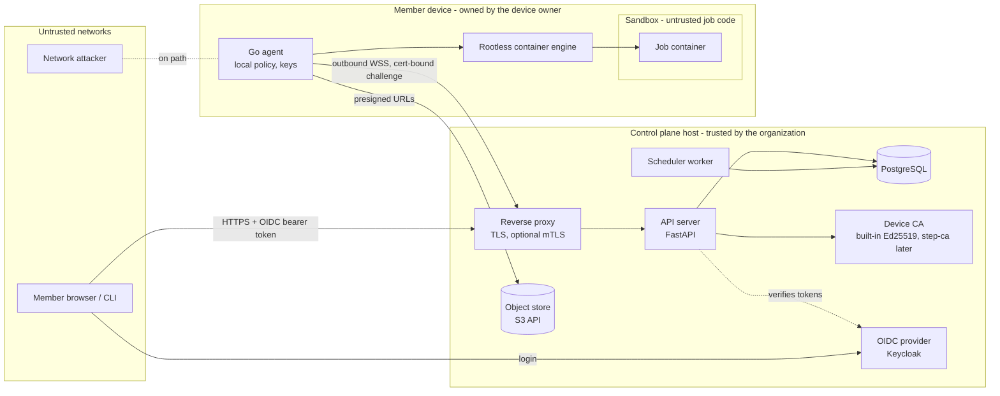

# Threat model v1

| | |
|---|---|
| **Status** | v1 draft. **Needs security reviewer sign-off.** Not reviewed yet. |
| **Date** | 2 November 2026 |
| **Scope** | Phase 0 and the first Phase 1 slice: control plane, scheduler, PostgreSQL, Go agent, sandbox, object store, identity and device CA, CLI and web UI |
| **Sources** | [`plan.md` §8](../plan.md#8-security-design), [`docs/design/phase1-implementation.md`](../docs/design/phase1-implementation.md), [ADR 0010](../docs/adr/0010-phase1-implementation-deviations.md) |

> **How to read the status column.** "Implemented in slice 1" means the
> design doc says the slice includes it. It does **not** mean it was tested
> against an attacker or reviewed. Before sign-off, a reviewer must check
> each item against the code and its tests. Update this file at the end of
> every phase (plan §8.10).

---

## 1. System and trust boundaries

Trust boundaries (each arrow that crosses a box):

| # | Boundary | What crosses it | Main control |
|---|---|---|---|
| B1 | Member ↔ control plane | REST calls, job specs, invites | OIDC token, per-call authorization, input validation |
| B2 | Agent ↔ control plane | Protocol messages, offers, commits | TLS, device certificate + signed challenge, signed task envelopes, fencing |
| B3 | Agent ↔ object store | Inputs, outputs | Presigned URLs (15 min), content hashes |
| B4 | Agent ↔ job container | Job code, outputs, logs | Sandbox tier, no host mounts, `--network none`, resource limits |
| B5 | Group A ↔ group B on one device | Caches, volumes, GPU memory | New container per attempt, per-group caches, per-attempt output dirs |
| B6 | Device owner ↔ job data | Memory, disk of a running job | Data classes; cannot be fully prevented (residual risk R2) |
| B7 | Control plane ↔ agent's local policy | Offers the server wants to run | Agent re-checks every offer against local policy |

## 2. Assets

| Asset | Why it matters | Where it lives |
|---|---|---|
| Owner's device: files, LAN access, compute | Main thing owners lend; harm here ends adoption | Member devices |
| Job inputs, outputs, checkpoints | May be internal or confidential research data | Object store, agent work dirs |
| Device private keys | Impersonating a device lets an attacker receive or forge work | Agent profile dir (0600); TPM/OS store later |
| Device CA private key | Can mint device certificates | Control plane host (`POOL_CA_KEY_FILE`) |
| Server envelope-signing key | Can make any agent run a job within its owner's policy | Control plane host (`POOL_SIGNING_KEY_FILE`) |
| OIDC tokens, CLI tokens | Act as a member, coordinator or admin | Browser, CLI config (0600) |
| Group membership and roles | Decide who can submit and approve | PostgreSQL |
| Audit log | Evidence of who ran what where | PostgreSQL, hash-chained |
| Secrets (later) | Credentials jobs use | Not built yet (Phase 3) |

## 3. STRIDE per component

S = spoofing, T = tampering, R = repudiation, I = information disclosure,
D = denial of service, E = elevation of privilege.

### 3.1 Control plane API (FastAPI)

| | Threat | Mitigation | Status |
|---|---|---|---|
| S | Forged or replayed user token | OIDC JWT signature, issuer, audience and expiry checked against JWKS | Implemented in slice 1 |
| S | Forged client-certificate header from the proxy | Proxy must strip incoming cert headers; app also verifies a signed challenge (X1) | Implemented in slice 1 (challenge); proxy config is deployment work |
| S | Dev-mode token issuer left on in production | Dev IdP only mounts when dev mode is set; must refuse in production config | Implemented in slice 1; **needs review** |
| T | Malformed job spec or protocol message | Strict Pydantic models, size limits, image must be pinned by digest | Implemented in slice 1 |
| R | Member denies submitting a job | Submitter recorded on every job; audit events for submit, start, stop | Implemented in slice 1 |
| I | Member reads another group's jobs, logs or devices | Authorization check on every endpoint scoped by group membership | Implemented in slice 1; authorization-matrix tests planned phase 5 |
| D | Submission flood | Per-member submission rate limit; quotas | Rate limit implemented in slice 1; quotas planned phase 2 |
| E | Member performs coordinator/admin action | Role checks; MFA (`amr`) required for coordinator and admin actions outside dev mode | Implemented in slice 1 |
| E | Device owner marks own laptop "org-owned dedicated" to attract confidential jobs | Only server admins can set that flag | Implemented in slice 1 |

### 3.2 Scheduler and lease manager

| | Threat | Mitigation | Status |
|---|---|---|---|
| T | Late commit from a device that lost its lease overwrites the real result | Epoch fencing: commit accepted only for the current attempt with matching epoch and active state | Implemented in slice 1 |
| T | Duplicate commit applied twice | Idempotent per (task, attempt) | Implemented in slice 1 |
| D | Task that always fails burns every device | Marked failed after failing on 2 different devices; backoff on retries | Implemented in slice 1 |
| D | Server restart expires every lease at once | One lease period of grace after start before expiring leases | Implemented in slice 1 |
| E | Task offered to a device that is not shared with the group | Server-side `device_shares` **and** agent-reported policy both required; agent re-checks | Implemented in slice 1 |

### 3.3 PostgreSQL

| | Threat | Mitigation | Status |
|---|---|---|---|
| T | Someone with DB access edits or deletes audit rows | Hash chain makes edits detectable; verify endpoint recomputes the chain | Implemented in slice 1. It detects, not prevents; DB admins remain trusted |
| I | Stolen DB backup leaks invite tokens or enrollment codes | Only SHA-256 hashes of invite tokens and enrollment codes stored | Implemented in slice 1 |
| I | Logs in the DB contain job secrets | No secrets yet; log scrubber planned with secrets | Planned phase 3 |
| D | Advisory lock on audit inserts becomes a bottleneck | Measure in load tests | Open |

### 3.4 Go agent

| | Threat | Mitigation | Status |
|---|---|---|---|
| S | Fake server (café Wi-Fi) | TLS; agent pins CA and server signing key at enrollment | Implemented in slice 1 |
| S | Stolen device key replayed | 24 h certificates, revocation deny list, re-enrollment needs owner login | Implemented in slice 1; TPM / OS key store planned |
| T | Compromised server sends a job the owner did not allow | Agent verifies envelope signature, `device_id`, expiry, then local policy (group, window, idle, submitter, tier, limits, egress, image allowlist) | Implemented in slice 1 |
| T | Offer replayed to a different device | Envelope bound to `device_id` and `expires_at` | Implemented in slice 1 |
| R | Owner cannot tell what ran on their machine | "What ran here" view from audit and attempts; local status command | Implemented in slice 1 (server view); tray icon planned |
| D | Owner loses use of their machine | Time windows, idle-only, limits, kill switch | Kill switch and limits in slice 1; idle detection needs spike S4 |
| E | Parser bug in protocol handling | Go is memory-safe; fuzzing of parsers | Fuzzing planned phase 5 |
| E | Stolen device key joins more groups (one-step sharing: the server records a share for every group the agent's policy offers) | Only groups where the device's owner is already a member with a sharing role; audit event `device.share` with source `local_policy`; a share turned off in the web UI stays off; 24 h certificates and revocation | Implemented (step 0 of `docs/design/easy-onboarding.md`); **needs security review** |

### 3.5 Sandbox (job container)

| | Threat | Mitigation | Status |
|---|---|---|---|
| E | Job escapes to host user or kernel | T1: rootless engine, non-root user, all capabilities dropped, `no-new-privileges`, default seccomp, read-only root. T2: gVisor. T3: Kata | T1 implemented in slice 1; T2 where `runsc` exists; T3 planned phase 3 |
| I | Job reads owner files | No host mounts except the per-attempt `/out` directory | Implemented in slice 1; escape suite in `agent/sandbox` |
| I | Job scans the LAN or reads cloud metadata | `--network none`; jobs asking for egress are declined (X5) | Implemented in slice 1; egress proxy planned phase 2/3 |
| I | Group A's job reads group B's data | New container per attempt; per-attempt output dir; per-group caches | Implemented in slice 1 (no caches yet); GPU memory clearing open |
| D | Crypto mining, fork bomb, disk fill | CPU, memory, pids limits, max runtime | Implemented in slice 1; disk quota per container open |

### 3.6 Object store

| | Threat | Mitigation | Status |
|---|---|---|---|
| S/E | Agent writes outside its attempt | Presigned URL per object, issued only for a fenced attempt | Implemented in slice 1 when a store is configured |
| T | Swapped input or output | Content addressing by SHA-256; upload URLs sign the SHA-256 (`x-amz-checksum-sha256`), so the store rejects a body that does not match | Implemented: hashes in commit, store-side check tested against SeaweedFS 4.50 |
| T | Device overwrites another task's output by claiming its hash | Same signed checksum: a device can only store the exact bytes for a hash | Implemented; tested in `tests/e2e/test_object_store.py` |
| E | Control-plane store credentials too broad | Example identity limited to the `pool-artifacts` bucket (`Admin:`, `Read:`, `Write:`, `List:`, `Tagging:` scoped to it); agents never see the keys | Implemented in `deploy/seaweedfs-s3.json.example` |
| I | Leaked presigned URL | 15 min expiry; bucket per group | Expiry in slice 1; bucket per group planned |
| I | Group member downloads another member's outputs | By design: group members see the group's jobs, logs and outputs (same as logs). Download links are issued only to group members, per file, for 15 minutes; the file name in the link is sanitised | Implemented; revisit with data classes |
| I | Data at rest on store host | Encryption at rest | Deployment config; open |

### 3.7 Identity provider and device CA

| | Threat | Mitigation | Status |
|---|---|---|---|
| S | Phished member password | MFA (required for coordinators and admins), k-person approvals, audit, alerts | MFA check in slice 1; on installed servers Keycloak reports TOTP in `amr` (`deploy/keycloak/configure.py`) and coordinators are guided to set it up; alerts planned |
| S | Brute-forced enrollment code | Single use, 10 min, high entropy, rate-limited endpoint, hash-only storage | Implemented in slice 1 |
| E | CA or signing key stolen from server host | Keys in files readable only by the service; KMS/OpenBao later | Open; key rotation procedure not written |
| T | Certificate kept after revocation | Deny list checked on every session; certificates not renewed | Implemented in slice 1 |
| S | Someone claims a freshly installed server before its admin | No open setup page: the installer creates the first admin with a one-time password shown only on the admin's terminal, kept root-only until shown, then deleted; Keycloak forces a new password at first sign-in | Implemented (step 1); **needs security review** |
| E | Strangers self-register on a public server and use it | Registration only creates an account; groups are invite-only and, by default on installed servers, only server admins create groups (`POOL_GROUP_CREATORS=admins`) | Implemented (step 1) |
| E | Keycloak admin console or master realm attacked from the internet | Not routed publicly (Caddy returns 404); reachable only on 127.0.0.1 through an SSH tunnel | Implemented and checked by `tests/vm/server_acceptance.py` |
| S | Members trust a wrong server CA (servers without a domain) | Installer prints the CA's SHA-256 fingerprint; agents pin the CA file at enrollment; with a domain, publicly trusted certificates are used instead | Implemented; trust-on-first-use remains for the CA file |
| I | Secrets on the server's disk | `.env` root-only (0600); file-store keys and the import file owned by the container user (uid 1000, often the cloud image's login user) | Implemented; secrets manager later |

### 3.8 CLI and web UI

| | Threat | Mitigation | Status |
|---|---|---|---|
| I | CLI token stolen from disk | Config file mode 0600; scoped, expiring tokens | 0600 in slice 1; scoped tokens planned |
| T | XSS in job names or logs shown in UI | React escaping; never render logs as HTML | Implemented in slice 1; needs review |
| S | CSRF | Bearer tokens, not cookies | Implemented in slice 1 |
| T | Malicious output path writes outside the download folder (`pool download`) | Output paths come from devices and are untrusted: the CLI refuses absolute paths and `..`, resolves inside the target folder, and saves a file only after its SHA-256 matches | Implemented; unit-tested |
| T/D | A hijacked or careless coordinator deletes a group | Coordinator only, two-step sign-in, type the name; group hidden but restorable for 7 days by a coordinator or server admin; audit events `group.delete`/`restore`/`purge` | Implemented; **needs security review** |
| R | Deleting jobs or groups hides what ran on members' computers | Audit log cannot be deleted (DB trigger); owners keep a `run_history` line per run; usage records stay (fair share cannot be reset by deleting) | Implemented |
| E | A coordinator removes or re-admits computers they do not own | Only from their own group (shares are per group); owners cannot override a removal; disabling a computer entirely stays with its owner, or a server admin for lost/stolen ones (two-step sign-in) | Implemented; **needs security review** |

## 4. The 12 threats from the plan (§8.2)

| # | Threat | Main mitigations | Status | Remaining risk |
|---|---|---|---|---|
| 1 | Job harms the device owner | Isolation tiers; no host mounts; no network; resource and time limits; kill switch; audit | T1/T2 and `--network none` in slice 1; T3 phase 3; egress proxy phase 2/3 | Sandbox escape bugs; Windows weaker |
| 2 | Device owner reads the job's data | Data classes; confidential only on dedicated org devices | Data class filter in slice 1; full enforcement phase 3 | Unavoidable on consumer hardware |
| 3 | Device returns a wrong result | Trusted groups; reliability score; opt-in `verify: 2` | Basic reliability score in slice 1; `verify: 2` planned phase 2 | Opt-in only |
| 4 | Stolen laptop or agent key | 24 h certs; revoke in UI; protected key storage; re-enrollment needs owner login | Slice 1, except TPM / Windows key store (open, Phase 0 choice) | Up to 24 h window unless revoked |
| 5 | Compromised user account | MFA for coordinators/admins; k-person approval; audit; alerts | Slice 1 except alerts (planned phase 2) | Damage limited to that user's rights |
| 6 | Member targets another member's device | `accept_from`; submitter recorded; rate limits; fast removal | Implemented in slice 1 | Same as #1 |
| 7 | Leak between groups on a shared device | New container per attempt; per-group caches and volumes; per-job network | Containers and outputs in slice 1; caches phase 2; per-job overlay phase 3 | GPU memory not cleared (open research item) |
| 8 | Control plane is compromised | Local policy and image allowlist on agent; pinned server key; signed agent updates; submitter-signed jobs | Local policy, allowlist, pinned key in slice 1; signed updates phase 5; submitter signing phase 5 | Attacker can still run jobs inside each owner's policy |
| 9 | Malicious container image | Digest pinning; registry allowlist; cosign; Trivy at submit | Digest pinning and allowlist in slice 1; cosign and Trivy planned phase 2 | Unknown vulnerabilities |
| 10 | Network attacker in the middle | TLS 1.3, mTLS, pinned CA, WireGuard overlay | TLS + cert-bound challenge + pinned CA in slice 1 (X1); mTLS at proxy is deployment; overlay phase 3 | Low if TLS is configured; **plain HTTP must never be used outside tests** |
| 11 | In-job framework exposed (ShadowRay) | Frameworks only on the job's private network, token auth on | Moot in slice 1 (`--network none`); applies from phase 3 | – |
| 12 | Resource abuse | Quotas, fair share, rate limits, credits | Rate limits and fair-share ordering in slice 1; quotas and credits phase 2 | – |

## 5. Residual risks to state plainly to owners and groups

| # | Risk | Why it stays |
|---|---|---|
| R1 | A kernel or runtime bug lets a job escape the sandbox | No sandbox is perfect. T2/T3 reduce the risk; T1 is weaker. |
| R2 | An owner with admin rights can read a running job's memory and disk | Consumer hardware cannot prevent this. Use data classes. |
| R3 | Windows devices top out at T1; all WSL2 distros share one kernel | No gVisor or Kata in WSL2 in v1 (spikes S2, S3). |
| R4 | GPU memory may not be cleared between jobs from different groups | Driver behaviour not verified (research item). |
| R5 | gVisor gives limited protection against NVIDIA driver bugs | Stated in gVisor's GPU documentation. |
| R6 | A compromised control plane can still run jobs within each owner's policy | Until submitter-signed jobs (Phase 5). |
| R7 | Stolen device key is usable for up to 24 h if nobody revokes it | Certificate lifetime. |
| R8 | The built-in device CA and dev-mode token issuer are new, unreviewed code | Slice 1 deviation X1; needs security review. |

## 6. Open items for the reviewer

1. Review the cert-bound challenge (X1) against replay, downgrade and
   proxy-header spoofing.
2. Decide where the CA and envelope-signing keys live in production, and
   write the key rotation procedure.
3. Confirm dev mode cannot be enabled by accident in the compose deployment.
4. Confirm the sandbox flags in `docs/design/phase1-implementation.md` §8
   match what the agent actually passes to the engine.
5. Choose the Windows key store (Phase 0 decision) and run spike S2.
6. Decide on open question 4 in the plan (does the owner see full job
   contents?), since it changes what "what ran here" shows.

## 7. Sign-off

| Role | Name | Date | Result |
|---|---|---|---|
| Security reviewer | _pending_ | | |
| Tech lead | _pending_ | | |
